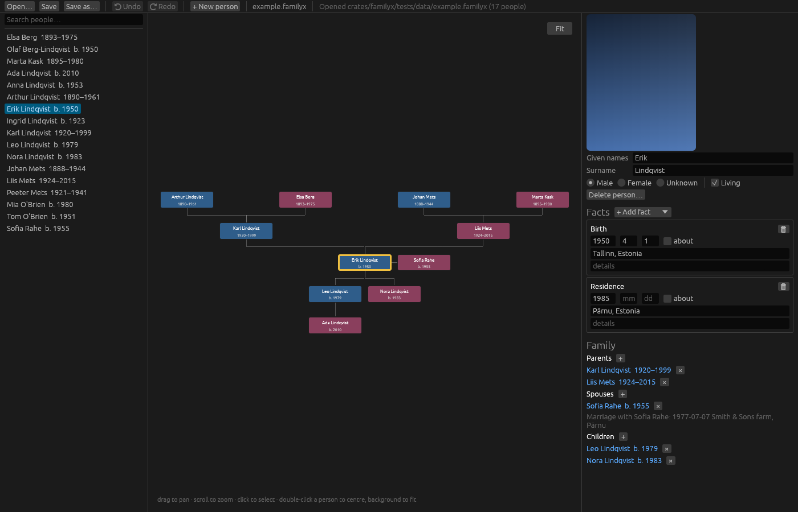

# Rootkin

**Your family tree on your own computer. No cloud, no account, no subscription.**

Rootkin is a free family tree editor for Linux, Windows and macOS, written in
Rust. Names, dates and photos stay in a file you own, and nothing is uploaded
anywhere. It opens, edits and saves `.familyx` files (the format of Chronoplex
*My Family Tree*), so a tree kept on Linux still opens in the Windows program.

Rootkin is an independent project and is not affiliated with Chronoplex Software.



## Features

- Private by design: works fully offline, with no telemetry and no network access
- Opens and saves `.familyx` without losing anything: data the editor does not
  understand is kept byte for byte
- Opens trees from older versions of My Family Tree and converts them
- People list with search and sorting, zoomable ancestor and descendant tree
- Edit names (including other names), gender, events (birth, death, marriage, ...),
  notes, sources and citations
- Add and link parents, partners and children; adoptive, foster and step parents;
  undo and redo
- Photos with face crops for the tree view
- Import and export GEDCOM (5.5.1 and 7.0) and Gramps XML, including photos
- Export the tree as SVG or PNG, and print family reports
- Safe saves: the previous version is kept as a `.bak` copy

## Install

- **Nix:** `nix run github:hkinks/rootkin`, or use the flake's `packages.default`
- **Downloads** for Linux, Windows and macOS will appear under
  [Releases](https://github.com/hkinks/rootkin/releases) with the first release

## Build from source

With Nix:

```sh
nix-shell
cargo run --release -p rootkin -- path/to/tree.familyx
```

Elsewhere you need a Rust toolchain (1.95 or newer) and the usual graphics
libraries for eframe/wgpu (Vulkan or OpenGL, Wayland or X11).

A command-line tool for developers is included:

```sh
cargo run -p rootkin-cli -- summary tree.familyx       # list people
cargo run -p rootkin-cli -- dump tree.familyx out.xml  # decoded XML
cargo run -p rootkin-cli -- export tree.familyx out.ged
cargo run -p rootkin-cli -- example new.familyx        # fictional sample tree
```

## Project layout

- `crates/familyx`: the `.familyx` format library (encryption, lossless XML, data model, edits, old-version conversion)
- `crates/rootkin-formats`: GEDCOM and Gramps import and export
- `crates/rootkin`: the desktop app (egui)
- `crates/rootkin-cli`: the command-line tool
- `docs/`: [design notes](docs/design.md), [TODO](docs/TODO.md), [UX review](docs/ux-review.md)

Status: early but usable. Keep backups of your trees; Rootkin also keeps a
`.bak` copy on every save.

## Privacy

Family trees contain personal data. The repository's `.gitignore` excludes
`*.familyx`, decoded XML and backups. The only trees in the repository are
fictional test data.

## License

Released into the public domain under the [Unlicense](UNLICENSE), or, at your
option, the [MIT license](LICENSE-MIT).
